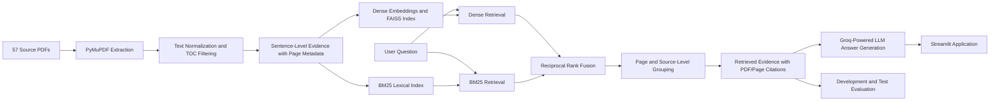

# Architecture

The notebook serves as a demonstration and experimentation client. The core ingestion and retrieval logic is implemented in [`src/rag_stock_market/pipeline.py`](./src/rag_stock_market/pipeline.py).

The system processes 57 source PDFs and builds a sentence-level evidence index containing document and page-level metadata. It uses dense vector retrieval with FAISS alongside BM25 lexical retrieval, combining their results through Reciprocal Rank Fusion (RRF). Retrieved evidence is then grouped by source and page to preserve document-level traceability.

The retrieved sentences are supplied as contextual evidence to a Groq-powered LLM, which generates responses grounded in the retrieved regulatory documents and their source references.

The PDFs are not used to fine-tune or train the underlying language or embedding models. Instead, they serve as the knowledge base for retrieval-augmented generation (RAG). The system's development and test evaluation workflows are maintained separately to assess retrieval performance.
