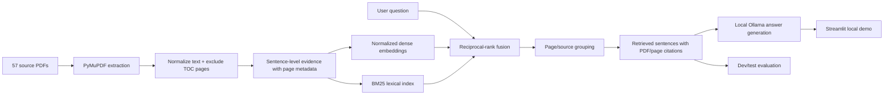

# Architecture

The notebook is a demonstration client. Production ingestion and retrieval
live in [`src/rag_stock_market/pipeline.py`](./src/rag_stock_market/pipeline.py).
The PDFs are not used to fine-tune the models. Ingestion creates a
sentence-level search index, and retrieval supplies relevant sentences as
context to the pretrained local answer model.
