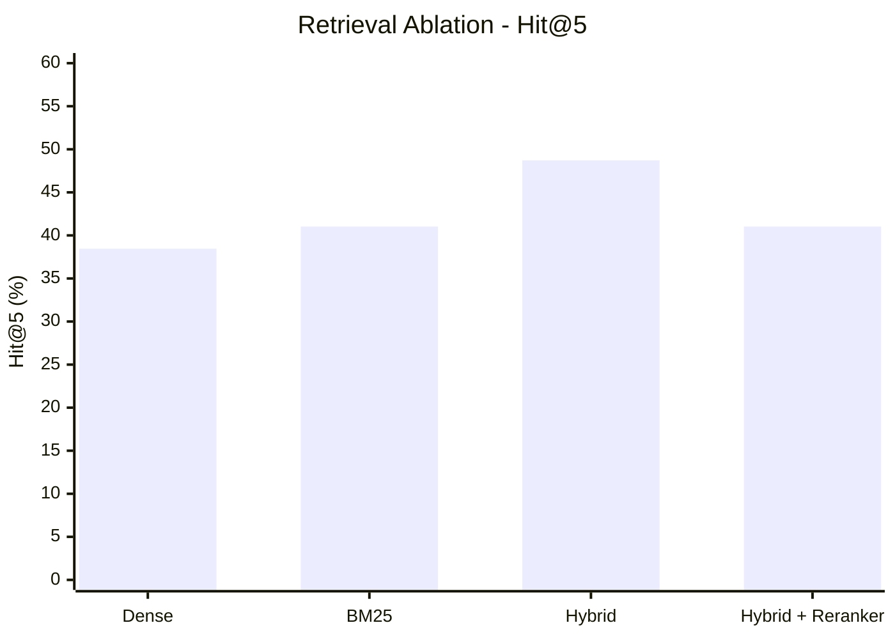

# Stock-Market PDF RAG

The production retrieval code is implemented in [`src/rag_stock_market/pipeline.py`](./src/rag_stock_market/pipeline.py). It is independent of notebook execution order and keeps the final test split isolated from configuration tuning.

## Local Demo

Run the local Streamlit question-answering application:

```powershell
streamlit run streamlit_app.py
```

The application indexes local PDFs as sentence-level evidence, retrieves the most relevant sentences, and uses Groq to generate answers grounded in that evidence.

Retrieved results are grouped by document and displayed with publisher, publication date, document status, and source-link metadata.

The answer model is not fine-tuned on the PDFs. Instead, the documents serve as the retrieval knowledge base, with relevant passages supplied as context to the pretrained language model.

See [`ARCHITECTURE.md`](./ARCHITECTURE.md) and [`RESULTS.md`](./RESULTS.md) for the system architecture and benchmark summary.

### Groq Setup

Set `GROQ_API_KEY` in your environment, then launch the application:

```powershell
streamlit run streamlit_app.py
```

The model name can be changed within the application. If the API key or Groq package is unavailable, the application displays an explicit setup error.

## Run the Evaluation

From the project directory:

```powershell
python evaluate_rag.py --data-dir data/raw --gold Golden_set_300.json
```

The evaluation script selects the BM25/dense fusion weight, candidate depth, and page/source grouping using only the 158 development questions. It then evaluates the selected configuration once on the 42-question test split.

Both page-level and document-level retrieval metrics are reported.

Page-level grouping is preferred when it improves exact evidence ranking. Document-level evaluation remains useful for document identification because some legacy chunk IDs resolve to table-of-contents pages rather than actual answer evidence.

Results and per-question failures are saved to `evaluation_results.json`.

The output also includes `audited_hit_at_k` and `audited_mrr_at_k`, which exclude legacy labels pointing to pages automatically identified as TOC pages. Original `hit_at_k` and `mrr_at_k` values remain unchanged for comparability.

The system intentionally does not use a cross-encoder reranker. Instead, it aggregates candidate evidence by source page first, matching the benchmark's document/page relevance labels while avoiding expensive, opaque reranking.

## Leakage Safeguards

- The test split is never used to select a configuration.
- Evaluation labels are converted from legacy chunk IDs to source/page evidence, so changing chunk size does not silently invalidate evaluation.
- Sentence records retain source, page, and section metadata for citations.
- Dense vectors are normalized and searched using inner product (cosine similarity).
- Lexical retrieval preserves financial terms such as `T+1`, `UPI`, `NAV`, and `ASBA`.
- Results are diversified across pages to avoid returning multiple overlapping passages from the same page.
- Development and test evaluation workflows remain separate.

The notebook remains a demonstration client. New experiments should use the package and commands described above rather than relying on notebook cell state.

## Benchmark Definition and Ablations

`Golden_set_300.json` contains 200 answerable labeled rows: 158 development and 42 test questions.

Each row stores a legacy `relevant_chunk_ids` label created using the original 1,800-character chunk size and 300-character overlap. The evaluator maps these IDs back to their source PDF and page before scoring because the production index uses differently cleaned chunks.

Run the clean, same-split ablation benchmark using:

```powershell
python run_ablations.py
```

This generates:

- `Golden_set_300_clean.json`
- `ablation_results.json`

The clean test set contains 39 questions. Source-selection, conflict-resolution, and adversarial meta-questions are excluded, while multi-document questions remain included.

These generated outputs are intentionally ignored by Git and should be regenerated when reproducing the benchmark.

The benchmark compares four retrieval configurations on the same questions:

1. Dense-only retrieval
2. BM25-only retrieval
3. Hybrid retrieval (Dense + BM25)
4. Hybrid retrieval with cross-encoder reranking

Hit@5 and MRR@5 include question-level percentile bootstrap 95% confidence intervals.

### Retrieval Ablation: Hit@5 Comparison

The following chart compares the retrieval configurations on the 39-question clean test benchmark.



| Retrieval Configuration | Hit@5 | MRR@5 |
|---|---:|---:|
| Dense-only | 38.46% | 24.23% |
| BM25-only | 41.03% | 31.07% |
| Hybrid (Dense + BM25) | **48.72%** | **36.62%** |
| Hybrid + Cross-encoder Reranker | 41.03% | 28.08% |

**Key observations:**

- Hybrid retrieval achieves the highest Hit@5 and MRR@5 among the evaluated configurations.
- Combining dense semantic retrieval with BM25 lexical retrieval improves evidence retrieval over either method independently.
- The cross-encoder reranker underperforms the hybrid baseline, so it was excluded from the final retrieval pipeline.
- Hybrid retrieval improves Hit@5 by approximately 10.26 percentage points over dense-only retrieval.

These results support the selection of hybrid retrieval without an additional reranking stage.

## Failure Analysis and Model Experiments

`failure_audit.json` classifies the 20 clean-test misses from the selected MiniLM configuration:

- 10 questions retrieve the correct PDF but not the labeled page.
- 10 questions retrieve a different PDF.

Several broad document-summary questions have a single-page gold label even though their wording asks about an entire document. These are label-quality issues rather than purely retrieval errors.

`fix_gold_mapping.py` creates `Golden_set_300_mapped.json` from the original gold set. It corrects only six verified TOC/front-matter/introduction-page mappings while preserving the original file.

`audit_and_repair_gold.py` performs the full-row rule audit and writes `Golden_set_300_rule_repaired.json`. It requires every target to belong to the question's `doc_id` or supporting documents and excludes TOC pages. The five TOC-only mismatches are repaired using lexical evidence over non-TOC pages.

The original clean-test result was 48.72% page Hit@5. After failure review:

| Evaluation Dataset | Hit@5 |
|---|---:|
| Original clean test | 48.72% |
| Manually corrected mapping | 53.85% |
| Fully rule-repaired mapping | 51.28% |

All results above use 39 questions.

These corrected results are post-review measurements and therefore should not be interpreted as untouched holdout performance.

Bootstrap 95% confidence intervals for the rule-repaired result are approximately:

- Hit@5: 35.90–66.67%
- MRR@5: 25.21–53.51%

The current environment reports `torch.cuda.is_available() == False` (`torch 2.10.0+cpu`), so embedding and reranker experiments were performed on CPU.

`model_experiment_results.json` records development-only embedding and chunking experiments.

MiniLM with 1,400-character chunks performed better than the tested BGE-base 1,000-character configuration with section-heading augmentation.

E5-base was installed and tested, but CPU throughput was too slow to complete the development run.

`reranker_diagnostic_results.json` records a bounded BGE-reranker experiment. It underperformed hybrid retrieval and was not selected for the final pipeline.

## Dataset and Evaluation Limitations

The current labeled corpus contains 200 answerable rows, of which 188 remain after removing the three meta-question categories.

The clean final test contains 39 questions.

No new independently labeled test split exists in the supplied data. The original 42-question test split remains untouched for final reporting.

Further validation using a larger, independently labeled dataset would help establish retrieval reliability across a broader range of regulatory questions.
